# Thuyết minh phần mềm PC Cleaner – Dọn dẹp máy tính

Phiên bản 0.2 · Tháng 11/2026 · Dùng cho Windows và macOS

## 1. Giới thiệu

Sau một thời gian sử dụng, ổ đĩa máy tính thường bị đầy bởi video cũ, bộ cài đặt đã dùng xong, ảnh chụp bị sao chép nhiều lần và đủ loại file người dùng không còn nhớ tới. Máy chạy chậm, báo hết dung lượng, nhưng người dùng không biết nên xóa gì để không mất dữ liệu quan trọng.

PC Cleaner giúp trả lời ba câu hỏi:

1. Cái gì đang chiếm chỗ trên máy?
2. Trong số đó, cái gì có thể dọn được?
3. Dọn thế nào để không bao giờ mất nhầm dữ liệu?

Nguyên tắc xuyên suốt của phần mềm là **an toàn trước, gọn gàng sau**: phần mềm chỉ đọc khi quét, không tự ý xóa bất cứ thứ gì, và mọi thao tác dọn dẹp đều có thể hoàn tác.

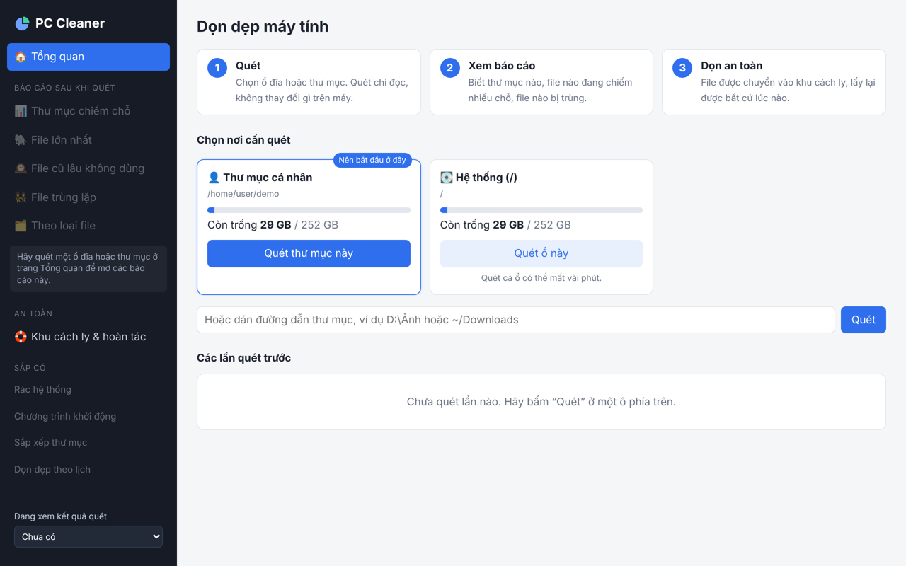

## 2. Tính năng và tác dụng

| Tính năng | Phần mềm làm gì | Tác dụng với người dùng |
|---|---|---|
| Tổng quan ổ đĩa | Hiện dung lượng đã dùng và còn trống của từng ổ, cảnh báo khi ổ sắp đầy | Biết ngay máy còn bao nhiêu chỗ |
| Thư mục chiếm chỗ | Vẽ sơ đồ ô vuông: thư mục càng nặng thì ô càng to; bấm vào để xem bên trong | Tìm ra "thủ phạm" chiếm dung lượng trong vài giây |
| File lớn nhất | Liệt kê các file nặng nhất, kèm loại file và thời gian sửa lần cuối | Dọn nhanh những file chiếm nhiều chỗ nhất |
| File cũ lâu không dùng | Tìm file lớn không được sửa trong 6 tháng, 1 năm hoặc 2 năm | Phát hiện video, bộ cài, bản sao lưu đã bị bỏ quên |
| File trùng lặp | Tìm các file giống hệt nhau về nội dung, dù khác tên hoặc nằm ở thư mục khác | Bỏ bản thừa, giữ lại một bản, lấy lại dung lượng bị lãng phí |
| Ảnh gần giống nhau | Tìm ảnh trông giống nhau dù khác file: ảnh chụp liên tiếp, ảnh đã thu nhỏ, nén lại, chỉnh sáng nhẹ | Bỏ bớt ảnh thừa, luôn giữ lại ảnh nét nhất |
| Theo loại file | Thống kê video, ảnh, tài liệu, bộ cài… mỗi loại chiếm bao nhiêu | Hiểu thói quen lưu trữ, biết nên dọn nhóm nào trước |
| Rác hệ thống | Tìm file tạm, bộ nhớ đệm, báo cáo lỗi, bản cập nhật đã tải xong của Windows/macOS và trình duyệt | Lấy lại dung lượng mà không phải tự lục từng thư mục ẩn |
| Khởi động cùng máy | Liệt kê chương trình tự chạy khi bật máy và chạy nền, gắn nhãn Có thể tắt / Nên giữ / Chưa rõ | Máy khởi động nhanh hơn; chỉ tắt, không gỡ, bật lại một chạm |
| Sắp xếp thư mục | Gom các file nằm lộn xộn trong Downloads, Desktop… vào thư mục con theo loại (và theo năm) | Thư mục gọn gàng; xem trước rồi mới di chuyển, hoàn tác được |
| Dọn dẹp theo lịch | Tự dọn rác hệ thống mỗi ngày/tuần/tháng, tự xóa hẳn khu cách ly quá hạn | Máy luôn gọn mà không phải nhớ |
| Khu cách ly và hoàn tác | File bị dọn được cất vào khu cách ly; có nút Lấy lại và Xóa vĩnh viễn | Không sợ xóa nhầm, đổi ý lúc nào cũng được |
| Nhật ký thao tác | Ghi lại mọi lần dọn, lấy lại, xóa vĩnh viễn và lý do file được giữ nguyên | Kiểm tra lại được mọi việc phần mềm đã làm |

### 2.1. Thư mục chiếm chỗ

Sau khi quét, phần mềm hiện sơ đồ ô vuông (treemap). Mỗi ô là một thư mục hoặc file, diện tích ô tỉ lệ với dung lượng. Bên dưới là danh sách sắp xếp từ nặng đến nhẹ. Bấm vào một thư mục để đi sâu vào trong, bấm "Quay lại" hoặc thanh đường dẫn phía trên để trở ra. Nút "Xem vị trí" mở thư mục đó trong File Explorer (Windows) hoặc Finder (macOS).

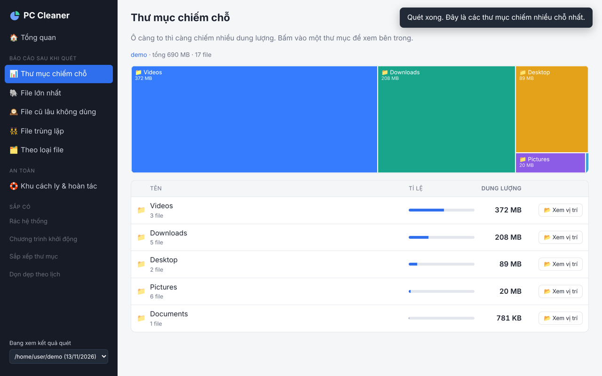

### 2.2. File lớn nhất và file cũ lâu không dùng

Hai báo cáo này liệt kê file theo dung lượng, kèm nhóm (Video, Ảnh, Tài liệu, Nén/bộ cài…) và thời gian sửa lần cuối ghi dễ hiểu, ví dụ "3 năm trước". Người dùng đánh dấu những file không cần nữa, thanh dưới cùng cho biết đã chọn bao nhiêu file và sẽ giải phóng bao nhiêu dung lượng. File thuộc hệ thống hoặc chương trình có biểu tượng khóa và không thể chọn.

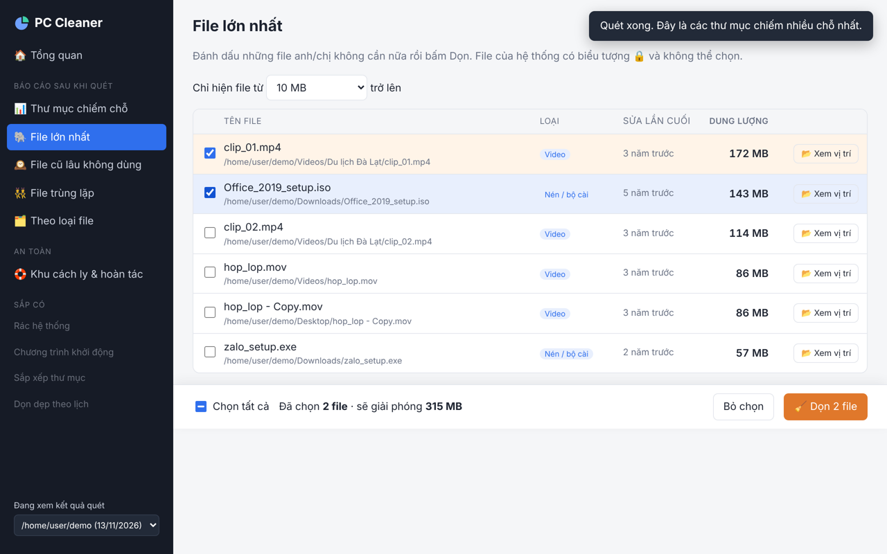

### 2.3. File trùng lặp

Phần mềm tìm những file có nội dung giống hệt nhau từng byte, kể cả khi tên khác nhau (ví dụ "IMG_001.jpg" và "IMG_001 (1).jpg"). Mỗi nhóm trùng được hiện cùng nhau. Phần mềm tự đề xuất giữ lại một bản (nhãn "Giữ lại") và đánh dấu sẵn các bản thừa. Người dùng có thể đổi lựa chọn trước khi dọn.

Cách chọn bản giữ lại, theo thứ tự ưu tiên:

1. Bản còn tồn tại trên ổ đĩa.
2. Bản nằm ngoài các thư mục tạm như Downloads, Desktop.
3. Bản có tên không giống bản sao (không có chữ "copy", "(1)", "bản sao"…).
4. Bản cũ nhất, rồi đến bản có đường dẫn ngắn nhất.

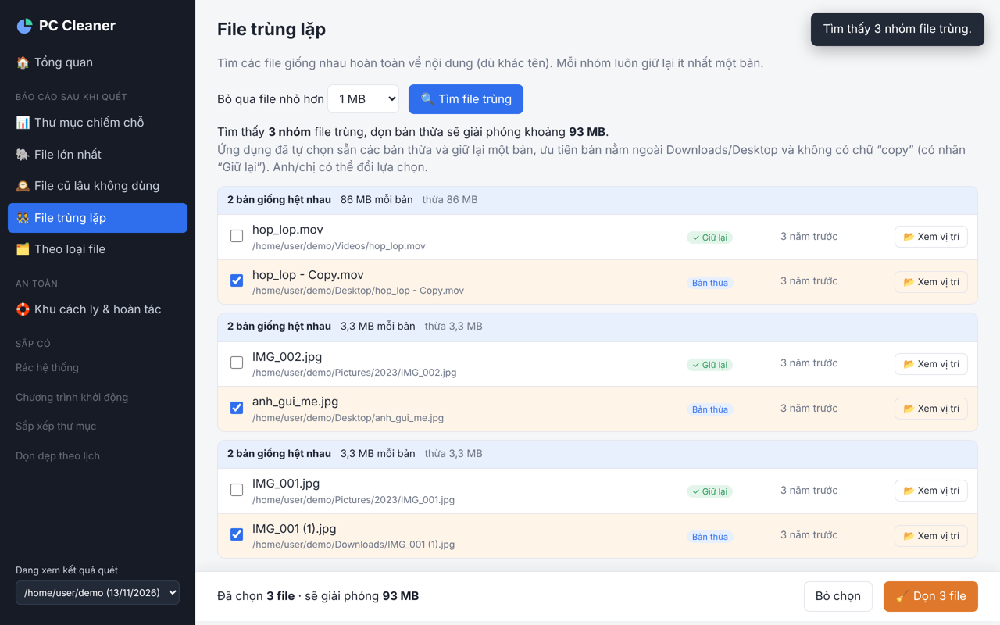

### 2.4. Dọn dẹp an toàn và hoàn tác

Khi bấm "Dọn", phần mềm hỏi lại và liệt kê đúng những file sắp được dọn. Sau khi đồng ý, file được chuyển vào khu cách ly chứ không bị xóa. Ngay sau đó có thông báo kèm nút "Hoàn tác" để đổi ý tức thì. Trong mục "Khu cách ly & hoàn tác", mỗi lần dọn là một dòng với nút "Lấy lại" (trả mọi file về đúng chỗ cũ) và "Xóa vĩnh viễn" (giải phóng dung lượng thật sự, phải xác nhận thêm một lần).

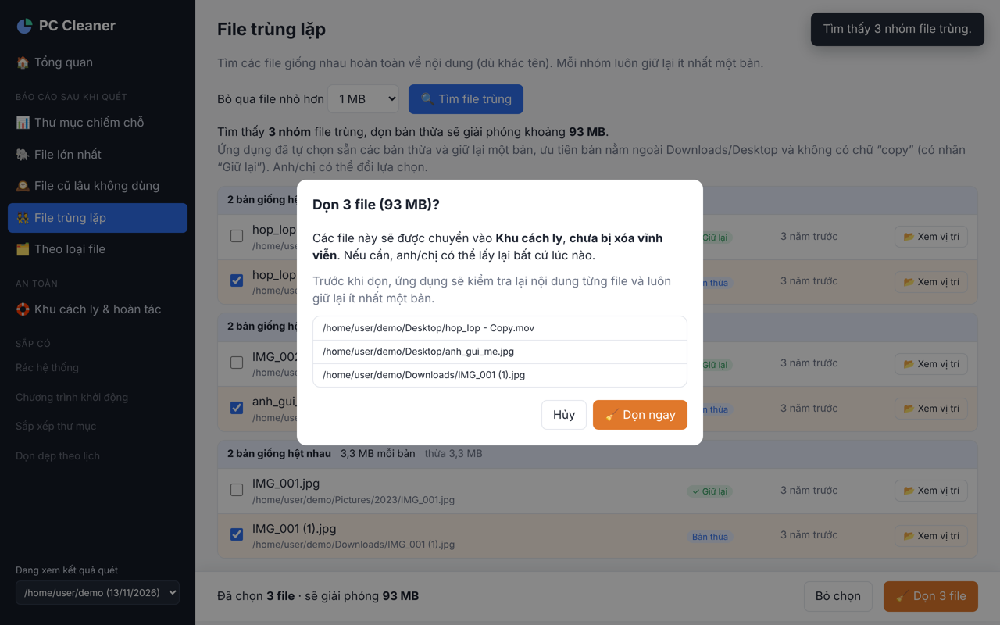

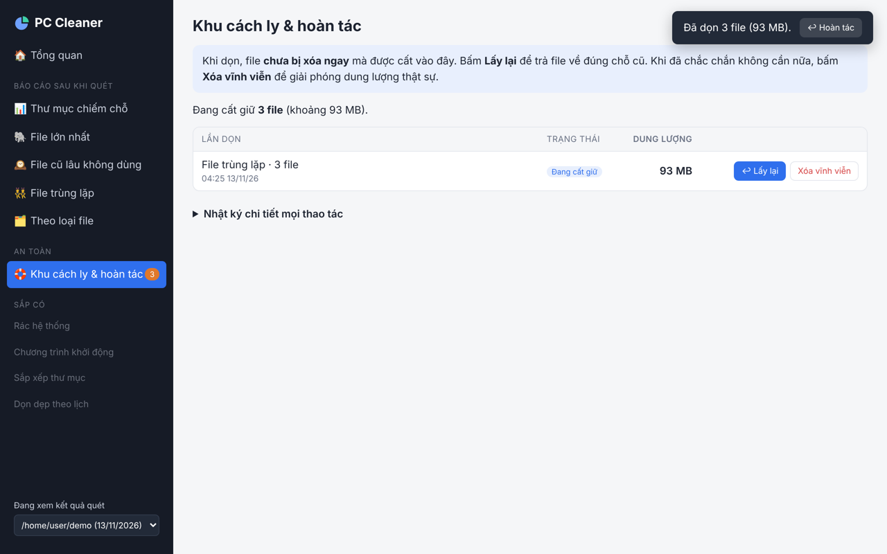

### 2.5. Ảnh gần giống nhau

Khác với file trùng lặp (giống hệt từng byte), mục này tìm những ảnh **trông** giống nhau: cùng một ảnh nhưng đã bị thu nhỏ để gửi Zalo, lưu lại với chất lượng thấp hơn, đổi sang định dạng khác hoặc chỉnh sáng nhẹ, và các ảnh chụp liên tiếp gần như y hệt. Ảnh được hiện dạng lưới thu nhỏ để người dùng nhìn tận mắt trước khi chọn.

Trong mỗi nhóm, ảnh có độ phân giải cao nhất được gắn nhãn "Giữ lại", các ảnh còn lại được đánh dấu sẵn. Có ba mức "Độ giống": Rất giống (chặt), Giống (khuyên dùng) và Hơi giống (rộng hơn, cần xem kỹ). Dù chọn thế nào, mỗi nhóm luôn giữ lại ít nhất một ảnh.

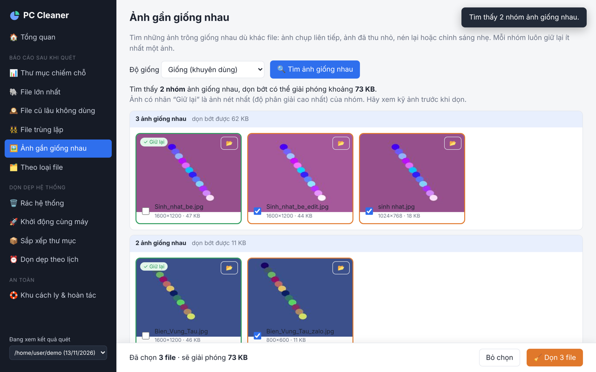

### 2.6. Rác hệ thống

Bấm "Kiểm tra rác hệ thống", phần mềm liệt kê từng nhóm rác kèm dung lượng và nhãn:

- Windows: file tạm của tài khoản và của Windows, bản cập nhật Windows đã tải xong, file lỗi (crash dump, báo cáo lỗi), bộ nhớ đệm ảnh thu nhỏ, bộ nhớ đệm trình duyệt (Chrome, Edge, Cốc Cốc, Firefox), Prefetch.
- macOS: bộ nhớ đệm ứng dụng, nhật ký, báo cáo lỗi, dữ liệu tạm của Xcode.

Nhãn **An toàn** nghĩa là ứng dụng sẽ tự tạo lại khi cần; nhãn **Cân nhắc** (ví dụ Prefetch, dữ liệu Xcode) nghĩa là xóa được nhưng có thể làm lần mở ứng dụng kế tiếp chậm hơn một chút. Chỉ các nhóm An toàn được chọn sẵn. File vừa được dùng trong 24 giờ qua được bỏ qua để không làm hỏng chương trình đang chạy. Rác cũng được chuyển vào khu cách ly như mọi lần dọn khác.

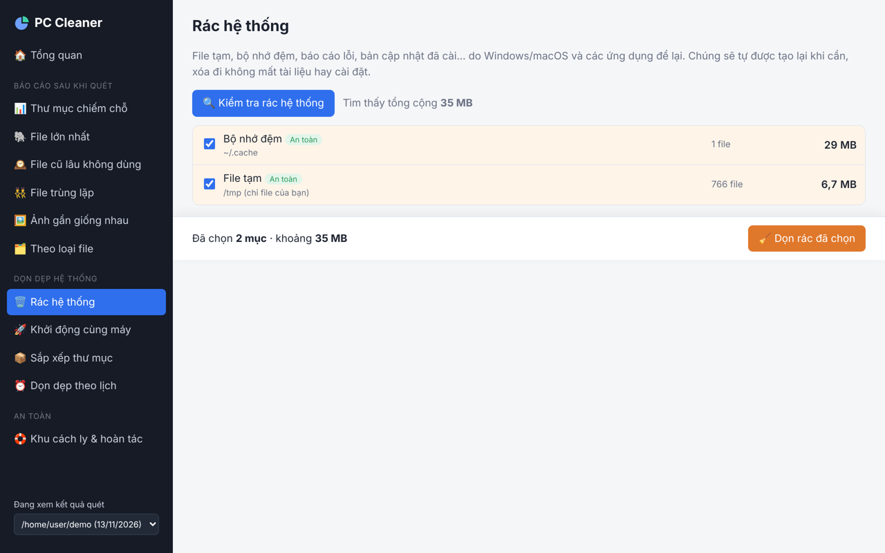

### 2.7. Khởi động cùng máy

Trang này liệt kê mọi thứ tự chạy khi bật máy: chương trình khởi động cùng Windows/macOS, tác vụ theo lịch, dịch vụ chạy nền (Windows) và Login Items, LaunchAgents (macOS). Mỗi mục có nhãn:

- **Có thể tắt**: ứng dụng hoặc trình cập nhật (Spotify, Zalo, Steam, Google Update…). Tắt chỉ khiến nó không tự mở, mở tay vẫn chạy bình thường.
- **Nên giữ**: liên quan đến bảo mật, phần cứng, bộ gõ tiếng Việt (Windows Security, UniKey, driver âm thanh…).
- **Chưa rõ**: phần mềm không nhận ra; nên tìm hiểu trước khi tắt.

Mỗi mục có một công tắc. Phần mềm **chỉ tắt, không bao giờ gỡ hay xóa** chương trình: gạt công tắc lại là bật lại như cũ. Mục ghi "Cần quyền quản trị" sẽ khiến Windows hỏi "Cho phép ứng dụng thay đổi thiết bị?". Trước lần thay đổi cần quyền quản trị đầu tiên, phần mềm đề nghị tạo **điểm khôi phục hệ thống** để có thể quay lại nếu cần.

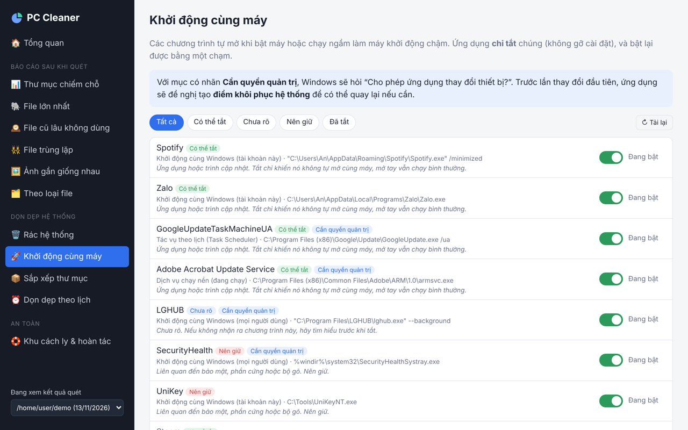

### 2.8. Sắp xếp thư mục

Chọn một thư mục hay bị lộn xộn (Downloads, Desktop, Documents hoặc thư mục bất kỳ), bấm "Xem trước". Phần mềm cho biết từng file sẽ được chuyển vào đâu: Ảnh, Video, Âm thanh, Tài liệu, Nén - Bộ cài, Lập trình, File tạm, Khác. Nếu bật "Chia ảnh và video theo năm", ảnh và video được xếp tiếp vào thư mục năm (ví dụ Ảnh/2026).

Chỉ các file nằm trực tiếp trong thư mục được sắp xếp; thư mục con có sẵn được giữ nguyên. Không file nào bị ghi đè: nếu trùng tên, file mới được đặt tên thêm " (2)", " (3)". Người dùng bỏ chọn những file không muốn di chuyển rồi bấm "Sắp xếp". Muốn quay lại, bấm "Hoàn tác" ngay trên thông báo hoặc trong Khu cách ly: mọi file trở về chỗ cũ và các thư mục mới tạo được xóa đi.

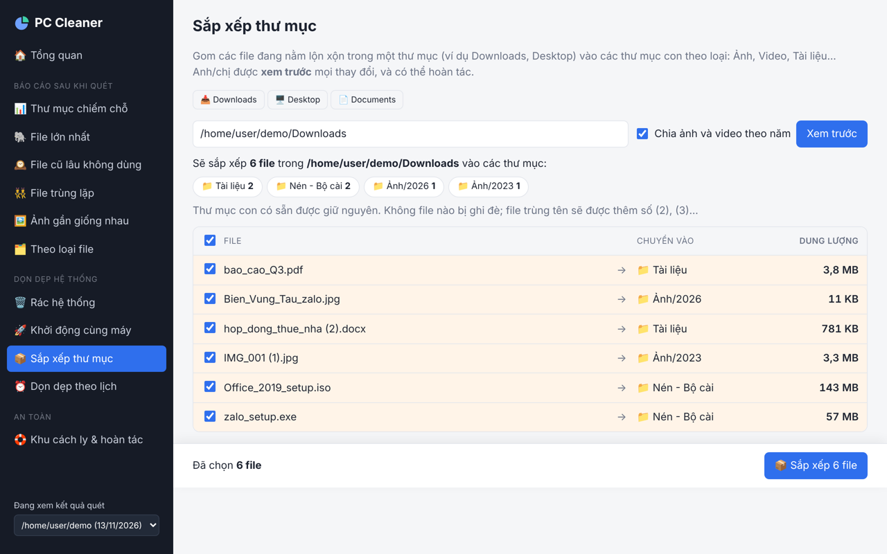

### 2.9. Dọn dẹp theo lịch

Bật "Dọn dẹp tự động", chọn tần suất (mỗi ngày, mỗi tuần vào Chủ nhật, mỗi tháng vào ngày 1) và giờ chạy. Đến giờ, máy tự dọn rác hệ thống, kể cả khi người dùng không mở phần mềm. Lịch chỉ dọn những nhóm rác có nhãn An toàn, và file vẫn vào khu cách ly. Người dùng cũng có thể chọn tự xóa hẳn những lần dọn đã nằm trong khu cách ly quá 7, 30 hoặc 90 ngày. Nút "Chạy thử ngay" giúp xem kết quả mà không phải chờ.

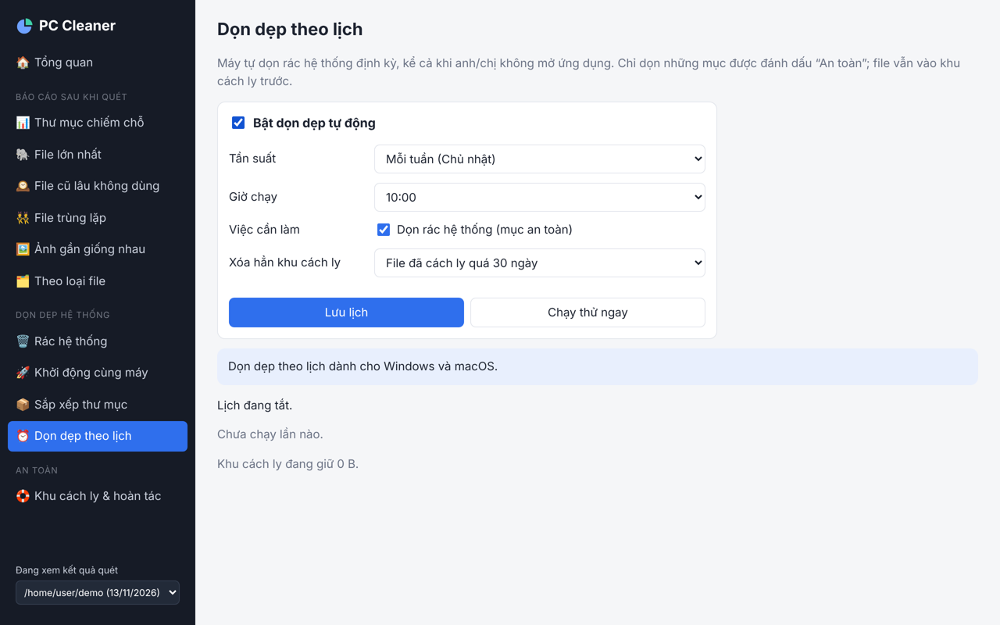

## 3. Hướng dẫn sử dụng nhanh

1. Mở phần mềm, ở trang Tổng quan bấm "Quét thư mục này" ở ô Thư mục cá nhân (nên bắt đầu ở đây), hoặc chọn một ổ đĩa hay một thư mục khác.
2. Chờ thanh tiến trình chạy xong. Phần mềm tự chuyển sang trang Thư mục chiếm chỗ.
3. Xem các báo cáo ở menu bên trái: File lớn nhất, File cũ lâu không dùng, File trùng lặp, Ảnh gần giống nhau, Theo loại file.
4. Đánh dấu những file không cần, bấm "Dọn", đọc lại danh sách và bấm "Dọn ngay".
5. Trong nhóm "Dọn dẹp hệ thống": kiểm tra rác hệ thống, tắt bớt chương trình khởi động cùng máy, sắp xếp thư mục Downloads, và bật dọn dẹp theo lịch nếu muốn (không cần quét trước).
6. Dùng máy vài ngày. Nếu không thiếu gì, vào Khu cách ly và bấm "Xóa vĩnh viễn" để giải phóng dung lượng. Nếu cần lại file nào, bấm "Lấy lại".

## 4. Nguyên lý hoạt động

### 4.1. Kiến trúc tổng thể

Phần mềm gồm ba lớp, tất cả chạy ngay trên máy người dùng, không gửi dữ liệu ra ngoài Internet:

| Lớp | Thành phần | Vai trò |
|---|---|---|
| Giao diện | Cửa sổ ứng dụng (pywebview) hiển thị trang HTML/JavaScript | Hiện báo cáo, nhận thao tác của người dùng |
| Máy chủ nội bộ | Máy chủ HTTP nhỏ viết bằng Python, chỉ nghe ở địa chỉ 127.0.0.1 | Nhận yêu cầu từ giao diện, chạy tác vụ quét/tìm trùng ở chế độ nền |
| Lõi xử lý và dữ liệu | Các mô-đun quét, tìm trùng, tìm ảnh giống, rác hệ thống, khởi động, sắp xếp, lịch, cách ly; cơ sở dữ liệu SQLite | Đọc ổ đĩa, tính toán, lưu kết quả và nhật ký |

Máy chủ nội bộ sinh một mã bí mật ngẫu nhiên mỗi lần mở phần mềm. Mọi yêu cầu phải kèm mã này, nên trang web hay chương trình khác trên máy không thể điều khiển phần mềm.

### 4.2. Quét ổ đĩa

Bộ quét đi qua cây thư mục theo kiểu "ngăn xếp": lấy một thư mục, đọc danh sách bên trong, thư mục con được đưa vào ngăn xếp để đọc tiếp, còn với mỗi file thì ghi lại tên, đuôi, dung lượng và thời gian sửa. Quá trình này **chỉ đọc**, không mở nội dung file và không thay đổi gì.

Một số điểm kỹ thuật bảo đảm kết quả đúng và an toàn:

- Không đi theo lối tắt (symlink) và junction trên Windows, để tránh vòng lặp vô tận và tránh đếm một thư mục hai lần. Thư mục OneDrive vẫn được quét bình thường.
- Trên macOS và Linux, các "hard link" (nhiều tên trỏ tới cùng một dữ liệu) chỉ được tính dung lượng một lần.
- Bỏ qua các vùng ảo hoặc do hệ thống quản lý như thư mục khôi phục hệ thống của Windows, /System/Volumes của macOS.
- Thư mục không có quyền đọc được bỏ qua và đếm lại để báo cho người dùng, quá trình quét không bị dừng.

Sau khi đọc xong, dung lượng được cộng dồn từ thư mục con lên thư mục cha chỉ trong một lượt duyệt ngược, nhờ thư mục con luôn được đánh số sau thư mục cha. Toàn bộ kết quả được ghi vào SQLite, nên mở lại báo cáo cũ hay chuyển giữa các trang không cần quét lại. Người dùng có thể bấm "Dừng lại" bất cứ lúc nào; khi đó kết quả dang dở được bỏ đi, không để lại dữ liệu sai.

### 4.3. Tìm file trùng lặp

So sánh trực tiếp mọi cặp file sẽ rất chậm. Phần mềm dùng phương pháp lọc ba tầng, mỗi tầng loại bỏ phần lớn ứng viên trước khi đến tầng tốn kém hơn:

| Tầng | Cách làm | Vì sao |
|---|---|---|
| 1. Kích thước | Nhóm các file có cùng dung lượng (byte) | Hai file khác dung lượng chắc chắn khác nhau. Không cần đọc file, rất nhanh |
| 2. Băm nhanh | Đọc 64 KB đầu và 64 KB cuối của file, tính mã SHA-256 | Loại nhanh phần lớn file cùng dung lượng nhưng khác nội dung |
| 3. Băm toàn bộ | Đọc toàn bộ file, tính mã SHA-256 | Xác nhận chắc chắn hai file giống hệt nhau từng byte |

SHA-256 là hàm băm mật mã: mỗi nội dung cho ra một "dấu vân tay" dài 64 ký tự. Hai file khác nhau gần như không thể có cùng dấu vân tay, nên phần mềm chỉ báo trùng khi nội dung thật sự giống nhau. Phần mềm đã được kiểm thử với cả trường hợp hai file cùng dung lượng, cùng phần đầu và phần cuối nhưng khác một byte ở giữa: chúng không bị báo trùng.

Mã băm được lưu lại kèm dung lượng và thời gian sửa của file. Lần tìm sau, file nào chưa thay đổi thì dùng lại mã cũ, không phải đọc lại.

Với các file OneDrive chỉ lưu trên mây (chưa tải về máy), phần mềm không tính mã băm, vì đọc chúng sẽ khiến Windows tải file về.

### 4.4. Cách ly, hoàn tác và xóa vĩnh viễn

Khi dọn, mỗi file được **di chuyển** (không xóa) vào thư mục cách ly riêng của phần mềm:

- Windows: `%LOCALAPPDATA%\PCCleaner\quarantine`
- macOS: `~/Library/Application Support/PCCleaner/quarantine`

Mỗi lần dọn có một mã riêng. Với từng file, phần mềm ghi vào nhật ký: vị trí gốc, vị trí trong khu cách ly, dung lượng, lý do và thời điểm.

- **Lấy lại**: đọc nhật ký và chuyển từng file về đúng vị trí gốc. Nếu ở vị trí gốc đã có một file khác, phần mềm không ghi đè mà báo lại cho người dùng.
- **Xóa vĩnh viễn**: chỉ thực hiện khi người dùng bấm và xác nhận. Phần mềm xóa bản trong khu cách ly và chỉ cộng vào "dung lượng đã giải phóng" những file thật sự được xóa.

### 4.5. Tìm ảnh gần giống nhau

Phần mềm tính cho mỗi ảnh một "dấu vân tay hình ảnh" 64 bit theo phương pháp dHash:

1. Thu ảnh về 9×8 điểm ảnh, đổi sang ảnh xám. Bước này xóa hết chi tiết nhỏ, chỉ giữ bố cục sáng tối.
2. Với mỗi hàng, so từng điểm với điểm bên phải: sáng hơn thì ghi 1, tối hơn thì ghi 0. Được 8×8 = 64 bit.

Ảnh thu nhỏ, nén lại hay chỉnh sáng nhẹ vẫn giữ bố cục sáng tối nên cho dấu vân tay gần như y hệt. Hai ảnh được coi là giống nhau khi số bit khác nhau (khoảng cách Hamming) không quá ngưỡng của mức Độ giống (Rất giống: 3, Giống: 6, Hơi giống: 7).

Để không phải so mọi cặp ảnh, phần mềm chia 64 bit thành 8 khối 8 bit. Hai ảnh khác nhau không quá 7 bit thì chắc chắn trùng nhau ít nhất một khối (nguyên lý chuồng bồ câu), nên chỉ cần so các ảnh có chung một khối. Các cặp giống nhau được gom thành nhóm. Dấu vân tay được lưu lại, lần sau ảnh nào chưa đổi thì không phải đọc lại. Ảnh thu nhỏ trên màn hình được tạo trực tiếp trong bộ nhớ, không ghi ra ổ đĩa.

### 4.6. Dọn rác hệ thống

Mỗi nhóm rác là một danh sách thư mục cố định, đã biết chắc là chỉ chứa dữ liệu tạm (ví dụ `%TEMP%`, `C:\Windows\SoftwareDistribution\Download`, `~/Library/Caches`). Phần mềm chỉ dọn **bên trong** những thư mục này, với các điều kiện:

- File phải cũ hơn một khoảng thời gian (thường 24 giờ; bản cập nhật Windows 72 giờ) để không đụng vào file chương trình đang dùng.
- Không đi theo lối tắt; không đụng vào file của tài khoản khác; không đụng vào thư mục dữ liệu của chính phần mềm.
- Ngay lúc dọn, đường dẫn thật của từng file được kiểm tra lại: nếu file nằm ngoài thư mục rác (ví dụ do lối tắt hoặc ".."), file bị từ chối.

Vì nhiều thư mục rác nằm trong vùng được bảo vệ (AppData, ~/Library), phần mềm chỉ mở ngoại lệ cho đúng các thư mục rác đã liệt kê, còn mọi phần khác của vùng bảo vệ vẫn bị chặn. File đang bị khóa được bỏ qua lặng lẽ, không báo lỗi.

### 4.7. Khởi động cùng máy

Phần mềm dùng chính cơ chế bật/tắt có sẵn của hệ điều hành, nên kết quả giống hệt khi tắt bằng Task Manager hay System Settings:

| Loại | Windows | macOS |
|---|---|---|
| Chương trình khởi động | Ghi cờ bật/tắt vào khóa `StartupApproved` trong Registry; mục khởi động gốc giữ nguyên | Login Items qua System Events |
| Tác vụ theo lịch | `Disable-ScheduledTask` / `Enable-ScheduledTask` | — |
| Dịch vụ chạy nền | Chuyển sang "Manual" (chạy khi cần), không tắt hẳn; chỉ dịch vụ của hãng thứ ba | `launchctl disable` / `enable` cho LaunchAgents, LaunchDaemons; file .plist không bao giờ bị xóa |

Mỗi thay đổi được ghi vào nhật ký kèm trạng thái cũ. Phần mềm chỉ nhận lệnh cho những mục vừa được liệt kê, nên không thể bị lợi dụng để sửa chỗ khác trong Registry. Thao tác cần quyền quản trị được chạy qua hộp thoại xin quyền chuẩn của hệ điều hành (UAC trên Windows, hộp nhập mật khẩu trên macOS). Điểm khôi phục hệ thống được tạo bằng lệnh `Checkpoint-Computer` của Windows.

### 4.8. Sắp xếp thư mục

Bản xem trước và lần sắp xếp thật dùng cùng một quy tắc: phần mềm tính lại kế hoạch ngay lúc sắp xếp và chỉ di chuyển những file người dùng đã chọn. Mỗi thư mục mới tạo và mỗi lần di chuyển đều được ghi vào nhật ký. Khi hoàn tác, file được trả về theo thứ tự ngược lại, rồi các thư mục do phần mềm tạo ra được xóa nếu đã trống. Thư mục có sẵn từ trước không bao giờ bị xóa. Thư mục hệ thống và chương trình không thể sắp xếp.

### 4.9. Dọn dẹp theo lịch

Phần mềm đăng ký một tác vụ với bộ hẹn giờ của hệ điều hành: Task Scheduler (tác vụ `PCCleaner\AutoClean`) trên Windows, LaunchAgent `com.pccleaner.autoclean` trên macOS. Đến giờ, hệ điều hành chạy phần mềm với tham số `--auto-clean`: phần mềm không mở cửa sổ, chỉ dọn các nhóm rác An toàn không cần quyền quản trị, xóa hẳn các lần dọn quá hạn (nếu được chọn), ghi kết quả rồi thoát. Tắt lịch là gỡ tác vụ đó khỏi hệ điều hành.

### 4.10. Các lớp bảo vệ chống mất dữ liệu

| Lớp bảo vệ | Cách hoạt động |
|---|---|
| Quét chỉ đọc | Bộ quét không mở, không sửa, không xóa file nào |
| Thư mục được bảo vệ | Không bao giờ dọn file trong thư mục hệ thống và chương trình. Windows: Windows, Program Files, ProgramData, AppData… macOS: /System, /Library, /Applications, ~/Library… Không bao giờ dọn ổ đĩa gốc hay thư mục dữ liệu của chính phần mềm |
| Chống lối tắt đánh lừa | Kiểm tra cả đường dẫn thật của file sau khi đi qua mọi lối tắt, nên một lối tắt trỏ vào thư mục hệ thống không thể dùng để dọn file hệ thống |
| Kiểm tra lại file trùng | Ngay trước khi dọn, băm lại từng file trùng để chắc nội dung chưa đổi kể từ lúc quét |
| Luôn giữ một bản | Nếu người dùng lỡ chọn tất cả các bản trong một nhóm trùng, phần mềm tự giữ lại một bản |
| Xác nhận trước khi dọn | Hộp thoại liệt kê đúng những file sắp được dọn |
| Cách ly thay vì xóa | File bị dọn vẫn nằm trong khu cách ly, lấy lại được bất cứ lúc nào |
| Không ghi đè khi lấy lại | Nếu vị trí cũ đã có file khác, file đó được giữ nguyên |
| Rác chỉ trong thư mục rác | Chỉ dọn bên trong danh sách thư mục rác cố định, file phải đủ cũ, kiểm tra lại đường dẫn thật ngay lúc dọn |
| Khởi động: chỉ tắt, không gỡ | Dùng cờ bật/tắt có sẵn của hệ điều hành, bật lại một chạm; điểm khôi phục trước khi đổi mục cần quyền quản trị |
| Sắp xếp: xem trước, không ghi đè | Hiện kế hoạch trước khi di chuyển, trùng tên thì đặt tên mới, hoàn tác xóa luôn thư mục vừa tạo |
| Lịch tự động thận trọng | Chỉ dọn nhóm rác An toàn, không xin quyền quản trị, file vẫn vào khu cách ly |
| Ảnh giống: luôn giữ một ảnh | Không cho dọn hết ảnh trong một nhóm |
| Nhật ký đầy đủ | Mọi thao tác và mọi file bị từ chối kèm lý do đều được ghi lại |

## 5. Yêu cầu hệ thống và cài đặt

- Windows 10/11 (64-bit) hoặc máy Mac chip Apple (M1 trở lên). Bản cho Mac chip Intel chưa được đóng gói sẵn, nhưng vẫn chạy được từ mã nguồn.
- Bản đóng gói sẵn (.exe cho Windows, .app cho macOS) được tạo tự động trên GitHub Actions sau mỗi lần cập nhật mã nguồn.
- Bản .app cho macOS chưa được ký số: lần đầu mở, bấm chuột phải vào ứng dụng rồi chọn "Open".
- Chạy từ mã nguồn: cài Python 3.10 trở lên, chạy `pip install -r requirements.txt` rồi `python run.py`.
- Tìm ảnh gần giống nhau dùng thư viện Pillow (đã có trong bản đóng gói). Ảnh HEIC của iPhone cần cài thêm `pillow-heif`.

Dữ liệu của phần mềm (bộ nhớ đệm kết quả quét, khu cách ly, nhật ký, cài đặt lịch) nằm trong thư mục `PCCleaner` đã nêu ở mục 4.4. Phần mềm không gửi bất kỳ dữ liệu nào ra ngoài máy.

## 6. Kiểm thử

Bộ kiểm thử tự động chạy trên cả Windows và macOS sau mỗi lần cập nhật, gồm các trường hợp:

- Dung lượng thư mục được cộng dồn đúng.
- Chỉ báo trùng những file giống hệt nhau; file cùng dung lượng, cùng đầu cuối nhưng khác ở giữa không bị báo trùng.
- Dọn rồi lấy lại trả file về đúng chỗ; xóa vĩnh viễn báo đúng dung lượng.
- File hệ thống bị từ chối, kể cả khi đi qua lối tắt.
- Chọn tất cả bản trùng vẫn giữ lại một bản; file đã thay đổi sau khi quét không bị dọn.
- Lấy lại không ghi đè file mới; dừng quét giữa chừng không để lại dữ liệu.
- Quét bỏ qua lối tắt và junction, không lặp vô tận.
- Ảnh gần giống: tìm đúng ảnh thu nhỏ, nén lại, chỉnh sáng; không gộp nhầm ảnh khác; luôn giữ lại một ảnh.
- Rác hệ thống: chỉ dọn file đủ cũ bên trong thư mục rác, không đi theo lối tắt ra ngoài, không thoát ra ngoài bằng ".."; lấy lại được.
- Khởi động cùng máy: tắt rồi bật lại một mục khởi động thật trong Registry (Windows) và một LaunchAgent thật (macOS); mục gốc không bị xóa.
- Sắp xếp thư mục: xem trước đúng, không ghi đè file trùng tên, hoàn tác trả file về và xóa thư mục vừa tạo; thư mục hệ thống bị từ chối.
- Dọn theo lịch: đăng ký và gỡ tác vụ thật với Task Scheduler/launchd; xóa hẳn khu cách ly quá hạn đúng dung lượng.

Lần chạy gần nhất: Windows 25 bài kiểm thử đạt (2 bài chỉ dành cho macOS được bỏ qua), macOS 25 đạt (1 bài chỉ dành cho Windows được bỏ qua).

## 7. Lộ trình phát triển

| Giai đoạn | Nội dung | Trạng thái |
|---|---|---|
| 1 | Quét ổ đĩa, báo cáo dung lượng, file lớn, file cũ, giao diện | Đã xong |
| 2 | Tìm file trùng lặp chính xác, khu cách ly và hoàn tác | Đã xong |
| 3 | Tìm ảnh gần giống nhau (ảnh chụp liên tiếp, ảnh đã nén lại) | Đã xong |
| 4 | Dọn rác hệ thống: thư mục Temp, bản cập nhật cũ, file lỗi, bộ nhớ đệm ảnh thu nhỏ (Windows); bộ nhớ đệm và nhật ký ứng dụng (macOS) | Đã xong |
| 5 | Quản lý chương trình khởi động cùng máy và chạy nền: chỉ tắt, không gỡ, bật lại một chạm; tạo điểm khôi phục hệ thống trước khi thay đổi (Windows) | Đã xong |
| 6 | Gợi ý sắp xếp thư mục, xem trước trước khi di chuyển | Đã xong |
| 7 | Dọn dẹp theo lịch | Đã xong |

Những phần chưa được thử trên máy thật (chỉ kiểm thử tự động): cửa sổ hộp thoại xin quyền quản trị (UAC) khi tắt dịch vụ hoặc mục "mọi người dùng", tạo điểm khôi phục hệ thống, và danh sách Login Items trên macOS (lần đầu macOS sẽ hỏi quyền cho phép điều khiển System Events).
